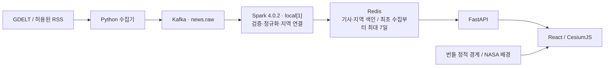

# TerraNewsphere

**지구 위의 뉴스.** 최근 7일의 뉴스를 3D 지구본에서 지역별로 둘러보는 뉴스 탐색 프로젝트다. 지구를 회전하거나 국가를 선택해 관심 지역의 뉴스를 찾고, 마커에 마우스를 올려 미리보기를 확인한 뒤 원문으로 이동한다.

## 용도와 주요 기능

- 세계 뉴스를 보도 지역과 함께 탐색하고 국가·행정구역으로 좁혀 본다.
- 뉴스 마커를 호버하면 썸네일·제목·제공 요약을, 클릭하면 출처·지역·원문 링크가 있는 카드를 표시한다. 출처가 제공하지 않는 요약이나 이미지는 만들지 않는다.
- 한국어·영어 화면, 뉴스 목록 이전/다음 페이지, 사이드바 접기와 모바일 화면을 지원한다. UI 언어와 기사 원문 언어는 별개다.
- Python 수집기, Kafka, 단일 Spark 스트리밍, Redis, FastAPI를 연결한 뉴스 처리 파이프라인을 개발·학습하는 데 사용한다.

뉴스는 최초 수집부터 최대 7일 동안 Redis에 보관하며, 같은 기사를 다시 받아도 만료를 연장하지 않는다. 정적 국가·행정 경계는 뉴스와 분리해 배포한다. 현재는 로컬 개발·테스트 환경이며 공개 운영 서버는 없다.

## 화면과 사용법

아래는 2026-10-16 실제 앱을 Chrome에서 실행해 캡처한 화면이다. **뉴스 제목·요약·기사 수는 사용법을 보여주기 위한 문서용 가상 데이터**이며 실제 보도가 아니다. 썸네일은 프로젝트의 기본 대체 이미지이고 예시 원문 링크는 `example.com`이다. 예시 응답은 캡처 브라우저에만 적용하며 운영 Redis에는 저장하지 않았다. [캡처 정보와 지도 출처](docs/screenshots/README.md)

### 1. 메인 화면에서 뉴스 찾기

왼쪽에는 전체 보관 기사 수, 지역 선택과 뉴스 목록이, 오른쪽에는 지구본과 뉴스 마커가 표시된다. 목록은 한 페이지에 최대 500개이며 하단의 **이전 / 다음**으로 이동한다. 지도의 기사 조회는 목록 페이지와 별도로 이루어지므로 표시되는 마커 수가 전체 보관 기사 수와 같지는 않다.


### 2. 지구본을 회전하고 크게 보기

지구본을 드래그해 회전하고 스크롤해 확대·축소한다. 왼쪽 위 사이드바 버튼을 누르면 지도 영역을 넓힐 수 있고, 지도 오른쪽 위 **◎** 버튼은 처음 시점으로 돌아간다.

마커는 기사당 대표 위치 하나를 사용한다. **민트색**은 확인된 사건 지점, **주황색**은 정확한 지점이 확인되지 않은 위치 또는 혼합 클러스터다. 국가만 알려진 기사는 국가 안에 보기 좋게 분산한 예시 위치이므로 실제 사건 발생 지점으로 해석하면 안 된다. 큰 마커의 숫자는 근처에 묶인 기사 수이며, 미리보기에는 그중 최신 날짜의 대표 기사가 표시된다.


### 3. 국가와 행정구역으로 좁히기

**지역 둘러보기**에서 국가를 선택하면 해당 국가로 이동하고 뉴스 범위를 좁힌다. 현재 상세 행정 경계가 번들된 국가는 한국이며, 확대 단계에 따라 ADM1·ADM2 경계를 불러온다. 행정구역 선택창이 나타나면 관심 지역을 더 좁힐 수 있다. 다른 국가는 국가 경계로 탐색한다.


### 4. 마우스를 올려 미리보기

마커에 마우스를 올리면 작은 카드에서 썸네일·제목·보도 지역을 확인한다. 요약은 제공된 경우에만 표시하고, 이미지가 없으면 대체 이미지를 사용한다. 주황색 마커의 위치 불확실성도 함께 안내한다.


### 5. 클릭해 기사 카드와 원문 열기

마커 또는 왼쪽 뉴스 목록의 기사를 클릭하면 지도 위치에 연결된 상세 카드가 열린다. 출처·제공 요약·관련 지역을 확인하고 **원문 기사 읽기**로 출판사 사이트를 새 탭에서 연다. **×**를 누르면 카드가 닫힌다. 앱은 기사 전문을 제공하지 않는다.


### 6. 모바일에서 보기와 언어 변경

좁은 화면에서는 사이드바를 접어 지구본을 크게 보고 마커를 탭해 기사를 연다. 헤더의 언어 선택으로 한국어·영어를 바꿀 수 있으며 선택은 브라우저에 저장된다. 기사 번역은 실제 저장된 번역이 있을 때만 사용한다.


## 데이터 흐름



Kafka는 수집과 처리를 분리하고 이벤트를 버퍼링한다. Spark는 정규화된 기사를 검증해 Redis에 멱등 저장하며, 브라우저의 뉴스 조회는 FastAPI/Redis를 사용한다. 지리 경계는 Redis 대신 정적 파일에서 불러온다.

## 로컬에서 실행하기

프로젝트 루트에서 실행한다. Python 3.12, uv, Node.js 22 이상, 실행 중인 Docker Desktop 또는 Docker Engine + Compose가 필요하다.

### 1. 의존성·지리 데이터 준비

```sh
sh scripts/setup.sh
```

이 명령은 고정 의존성을 설치하고 국가 경계·한국 ADM1/ADM2·서버용 위치 매핑을 생성한다. 기존 지리 번들과 다운로드 캐시를 재사용하며, `.env`가 없을 때만 `.env.example`을 복사한다. 최초 준비에는 외부 네트워크가 필요하다. 전 지구 표면은 구름층 없는 NASA Blue Marble Base Map 로컬 타일(원본 21600×10800, 타일 약 32MiB)을 사용한다. 행정 경계도 로컬 정적 파일을 사용한다. 확대 배경 지도는 OSM 타일을 받아오므로 인터넷 연결이 필요하며, 실패하면 로컬 경계 지도로 돌아간다.

인증서 오류가 발생하고 검증 생략을 원하는 로컬 환경에서는 다음 명령을 사용한다.

```sh
TERRA_SKIP_TLS_VERIFY=1 sh scripts/setup.sh
```

이 옵션은 이번 준비 실행의 uv/npm/지리 다운로드에만 적용된다. Docker 이미지 다운로드나 이미지 내부 빌드의 인증서 설정은 별도다.

회사 네트워크처럼 추가 CA가 필요한 Docker 빌드는 기존에 신뢰한 CA 파일을 BuildKit secret으로 전달한다. CA나 개인키를 저장소에 넣지 않는다. TLS 검증은 유지한다.

```sh
export TERRA_CA_CERT=/absolute/path/to/trusted-ca.crt
export COMPOSE_FILE=compose.yaml:deploy/compose.local-ca.yaml
```

이 설정 후 아래 Compose 명령을 그대로 사용한다. API·수집기·Spark 이미지는 전달된 CA를 시스템 trust store에 설치한다. 프런트는 의존성 설치 단계에만 사용한다. 추가 CA가 필요 없는 환경과 CI는 기본 compose.yaml을 사용한다.

정적 지리 번들은 저장소에 포함돼 있다. Natural Earth 50m 국가 경계(ISO 코드 236개)와 한국 ADM1 17개·검증된 ADM2 189개를 제공한다. 상위 지역을 확정할 수 없는 ADM2 39개는 제외 목록에 기록했다. 준비 명령은 기존 번들을 재사용한다. 확대 시 상세 배경 지도 위에 벡터 경계를 표시하고 국가·행정구역 이름을 표시한다. 뉴스 목록·미리보기에는 실제로 확인된 보도 지역을 함께 보여준다.

### 2. 서비스 실행

```sh
python3 scripts/security_setup.py
docker compose up --build -d --wait
```

브라우저에서 **http://localhost:8080**에 접속한다. API·프런트·수집기·Kafka·Spark·Redis가 함께 실행된다. 최초 수집과 Spark 처리까지 시간이 걸릴 수 있으며, 위치를 확인할 수 없는 뉴스는 목록에만 표시될 수 있다. 별도 Redis나 Kafka를 호스트에 설치할 필요는 없다.

### 3. 수집 상태 확인

```sh
docker compose logs --tail=100 collector spark
```

Spark 이미지는 Java·PySpark·Kafka 커넥터를 준비하므로 최초 빌드가 더 오래 걸릴 수 있다. UI에서는 검증용 데모 기사를 제외하므로 데모 입력만으로 화면을 채우지는 않는다. README 캡처의 가상 뉴스는 사용법을 설명하기 위한 별도 브라우저 예시다.

수집기는 시작 즉시 최근 7일 뉴스의 초기 수집을 진행하고, 이후 기본 15분 간격으로 GDELT DOC API와 설정된 RSS를 수집한다. DOC 최초 정상 조회는 7일/최대 250건이고 이후에는 1시간/최대 250건이다. 최신 GKG의 동일 URL에서 국가 언급을 보완한다. 출판사 국가를 사건 위치로 사용하지 않는다. 국가만 연결된 기사의 저장 좌표는 수도 fallback이며, 화면에서는 불확실성을 표시하고 국가 안에 분산해 보여준다. 국가 연결도 확인할 수 없는 기사는 지도 마커로 만들지 않는다. 없는 요약·번역을 만들거나 GDELT 이미지 URL을 자동 사용하지 않는다.

GDELT DOC 호출은 기본 900초 간격이며 설정을 낮춰도 최소 60초를 유지한다. HTTP 429 또는 HTTP 200 본문의 호출 제한 안내를 받으면 기본 설정에서 15분→30분→60분으로 대기를 늘린다. 더 긴 `Retry-After`는 그대로 존중하며 정상 응답 후 기본 간격으로 돌아간다. Redis의 일시적 요청 gate로 재시작 후에도 최소 간격과 제공자 대기를 유지한다. 이 대기는 GDELT에만 적용하고 RSS는 계속 수집한다. 빈 기사 응답에서는 GKG 파일을 내려받지 않는다. 외부 서비스/IP 제한 자체를 해제하는 조치는 아니다.

로컬 기본 RSS는 BBC 20개·SBS 7개·Le Monde 10개·UN Geneva 1개, 총 38개다. 제공된 설명과 허용된 썸네일·원문 링크를 표시한다. 전체 보관 기사 수와 현재 페이지 수를 구분하고 500개씩 이전/다음으로 탐색한다. UI에서는 데모를 제외하며 위치 미확인 뉴스도 전체 목록에서 볼 수 있다. 개인 로컬 RSS 사용 조건·상업 배포 조건과 위치 불확실성은 [뉴스 소스 문서](docs/news-sources.md)를 참조한다. 초기 수집은 Kafka/Spark를 거쳐 Redis에 적재되며, 중복 수집으로 만료 시각을 늘리지 않는다.

RSS를 추가하려면 `.env`의 `RSS_URLS`와 `collector/rss-policy.json`을 설정한다. 위치와 썸네일 정책은 해당 피드의 실제 보도 범위·사용 권한을 확인한 값만 지정한다.

### 상태 확인과 종료

```sh
docker compose ps
docker compose logs --tail=100 api collector spark
docker compose down
```

`down`은 Kafka·Spark의 named volume을 유지한다. Redis는 휘발 저장이므로 재시작하면 뉴스가 사라진다. Redis/Kafka 포트는 호스트에 공개하지 않고 웹 포트만 localhost에 연결한다. 웹 포트 변경은 `.env`의 `WEB_PORT`를 사용한다.

## 한 번의 최종 검증

준비 명령을 완료한 뒤 실행한다.

```sh
.venv/bin/python scripts/verify.py --containers
```

Python 구문, 프런트 빌드, Compose/K3s 설정, 격리된 실제 Redis의 파싱·중복·만료·지역 조회·API, Kafka→Spark→Redis→HTTP 전달을 순서대로 확인한다. 로컬 Compose 서비스는 검증 후에도 유지한다. API 테스트에는 운영 Redis를 사용하지 않는다.

이미 빌드·설정 검사가 통과했고 서비스 단계만 재개한다면 다음 명령을 사용한다.

```sh
.venv/bin/python scripts/verify.py --containers --services-only
```

준비부터 전체 검증까지 한 명령으로 실행할 수도 있다.

```sh
sh scripts/complete-local.sh
# 로컬 인증서 검증 생략이 필요할 때
TERRA_SKIP_TLS_VERIFY=1 sh scripts/complete-local.sh
```

Python 구문·프런트 빌드·Compose/K3s 설정, 실제 Redis의 중복·7일 만료·지역 조회·API, ARM64 Kafka→Spark→Redis→HTTP 연결 검증을 통과했다. 로컬 Chrome에서 지구 렌더링, 한국 확대, ADM1/ADM2 단계별 로딩, 뉴스 카드·원문 링크, 언어 저장, 모바일 화면도 확인했다. 자세한 결과와 지리 지원 범위는 [구현 진행 기록](docs/implementation-progress.md)을 따른다.

실제 뉴스 수는 수집 시점과 피드 응답에 따라 달라진다. GDELT가 호출을 제한하면 정해진 대기 후 재시도하며 RSS는 계속 처리한다. 브라우저 사용법 캡처는 런타임 전체 파이프라인 검증을 대신하지 않는다.

## 디렉토리

```text
backend/terra_newsphere/  기사 모델, 위치 검증, Redis 접근, FastAPI
collector/               GDELT/RSS 수집, GKG 국가 언급 보완
kafka/                   KRaft 배포, news.raw 생성과 보존 설정
spark/                   단일 Spark 처리기, 체크포인트, 이미지
redis/                   휘발 저장 설정, 원자적 기사·인덱스 갱신 Lua
frontend/                React/Cesium UI, 정적 지리 경계
geo/                     출처·버전·라이선스, 서버용 위치 매핑
scripts/                 준비, 지리 가공, 데모 입력, 최종 검증
deploy/                  Python 이미지, 단일 노드 K3s
tests/                   핵심 Redis/API 사이클
docs/                    데이터 계약, 지리, 운영, 재개 기록
```

## 설정 파일과 Git

브랜치는 `feature/* → dev → prd`로 관리한다. 기본 개발 브랜치는 `dev`, 운영 후보 브랜치는 `prd`다. 기능별 PR과 필수 검사, 로컬 테스트 절차는 [브랜치 관리](docs/branching.md)를 따른다. 현재 운영 서버는 없으며 자동 운영 배포는 연결하지 않았다.

`.env.example`에는 안전한 기본값과 설정 이름만 저장한다. `.dockerignore`, `.gitignore`, `.env.example`, Python/npm 잠금 파일, 소스·배포·문서는 커밋한다.

실제 `.env`와 환경별 env 파일, 개인키·인증서 비밀 파일, AWS 자격 증명, Kubernetes Secret 파일은 제외한다. `node_modules`, `.venv`, 캐시, 빌드 결과, 로컬 실행 로그·체크포인트도 커밋하지 않는다. 준비를 마친 정적 지리와 출처·라이선스는 버전 관리 대상이다.

## 배포와 재개

현재 서버 배치는 Oracle Cloud A1 ARM64 + 단일 노드 K3s를 대상으로 한다. 전체 Kafka/Spark/Redis 구성을 1코어·1GB에 정상 운영하는 것은 어렵다. Vercel에는 프런트와 FastAPI를 배포할 수 있지만 Kafka·Spark와 Redis 저장소는 별도 실행 환경이 필요하다. 실제 클라우드 배포는 아직 수행하지 않았다.

배포는 [운영 문서](docs/operations.md), 저장 규칙은 [데이터 계약](docs/data-contract.md), 경계 출처·가공은 [지리 데이터](docs/geography.md)를 참고한다.

중단 후에는 **“AGENTS.md와 docs/implementation-progress.md를 읽고 첫 미완료 단계부터 이어서 해줘”**라고 요청한다. 현재 준비 단계는 `.runtime/setup-stage.txt`에 기록된다.

## 공개 배포 보안

Redis 서비스별 ACL/secret, nginx 반복 호출 제한과 429, K3s HTTPS 및 내부 네트워크 격리, 도메인/인증서와 DDoS 보호는 [보안 문서](docs/security.md)를 참조한다. 민감한 값은 Git에서 제외되는 `.env`에서 관리한다. `.env.example`에는 값 없는 설정만 있으며, `python3 scripts/security_setup.py`가 기존 비밀번호를 유지해 `.env`와 컨테이너 secret 파일을 준비한다. Compose를 실행하기 전에 이 명령을 실행한다.
