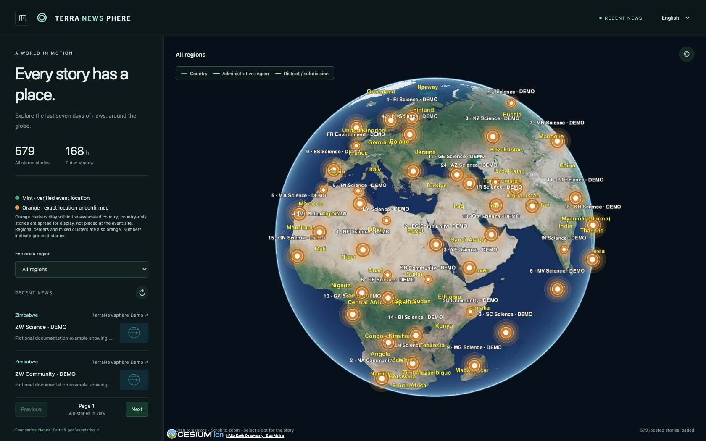
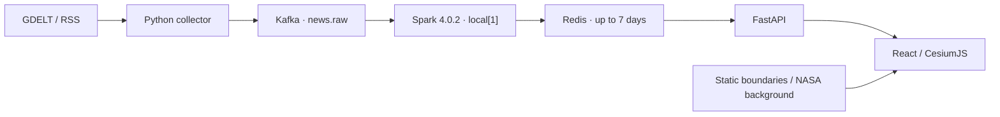
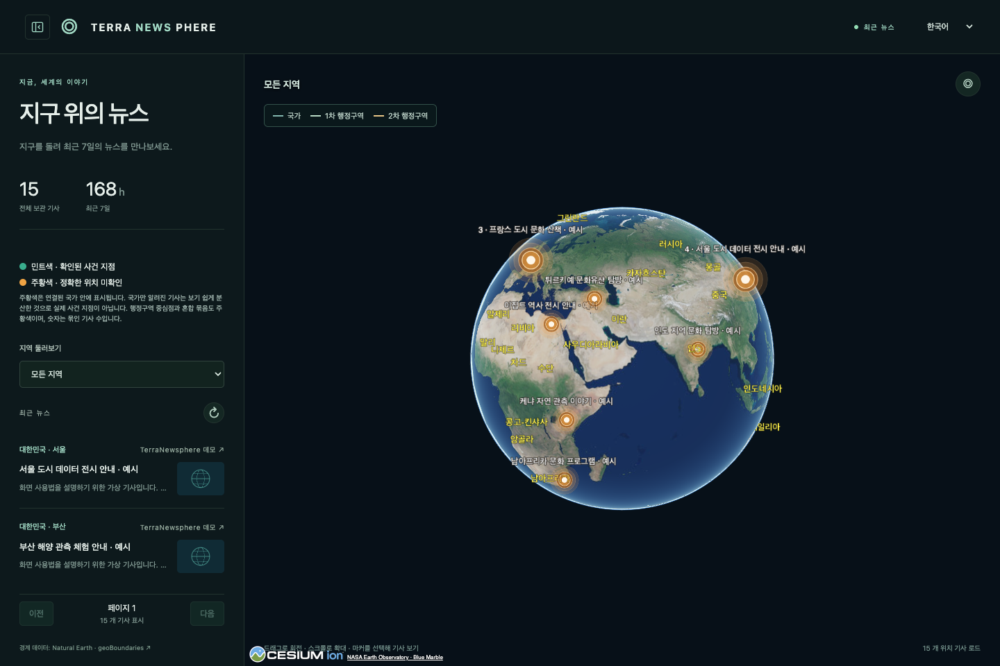
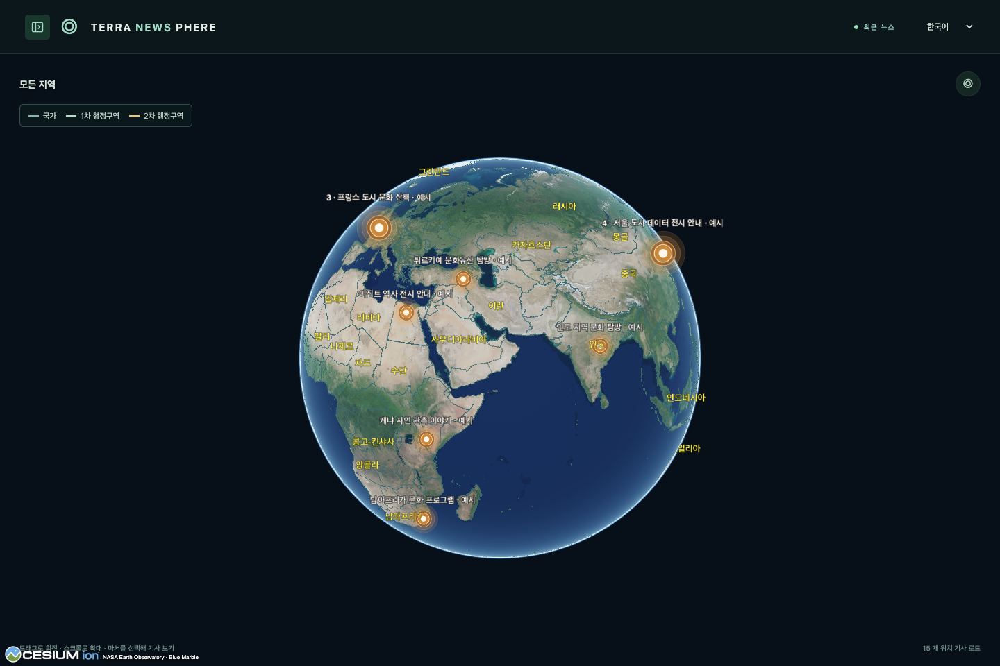
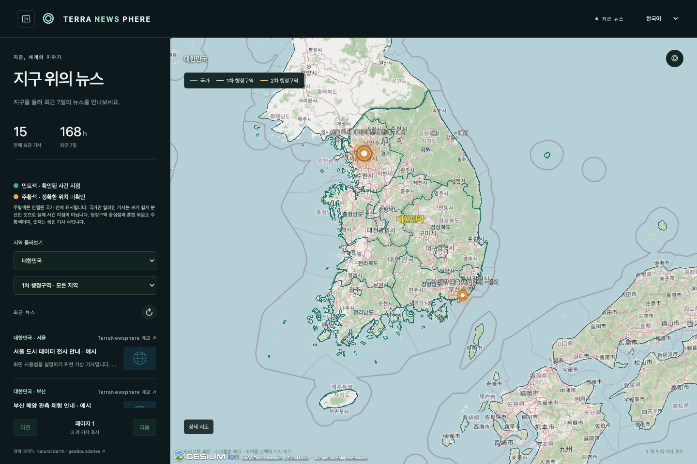
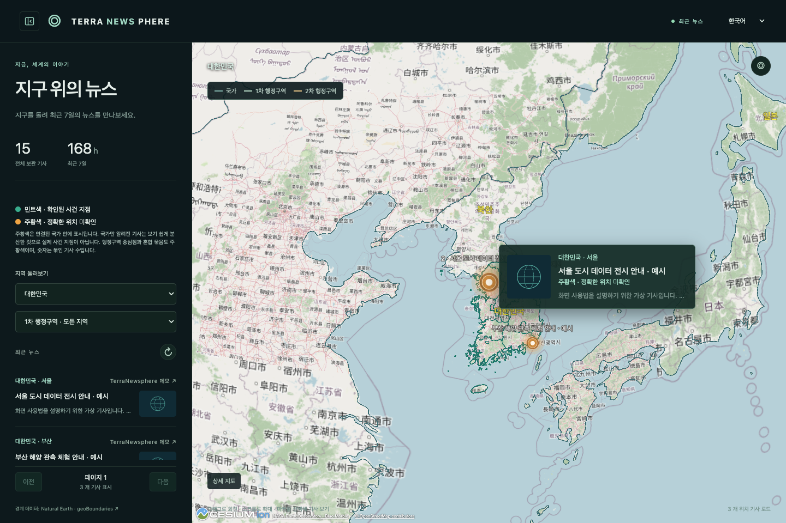
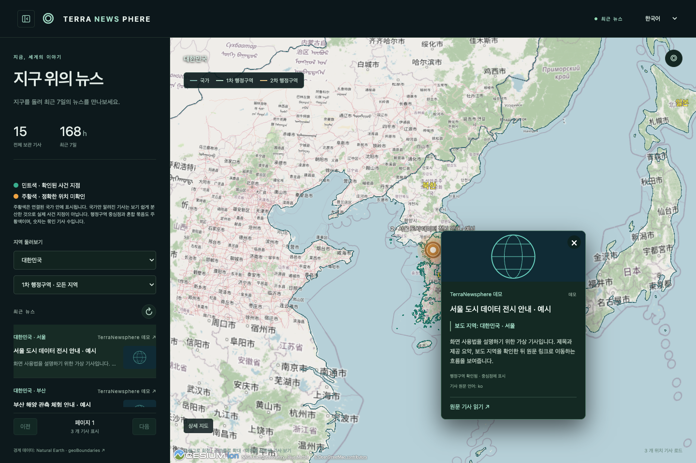
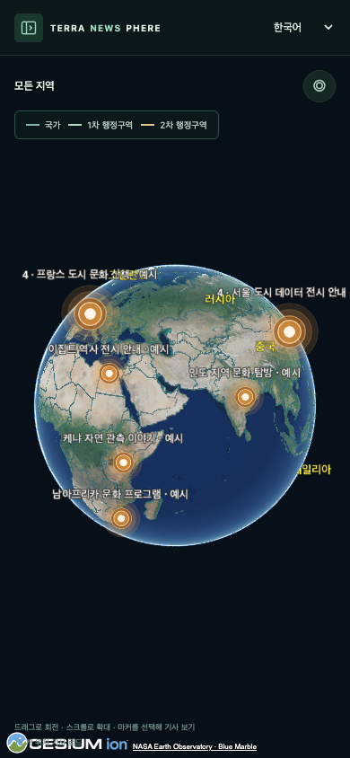

# TerraNewsphere

Contact / 문의: [jaemanc93@gmail.com](mailto:jaemanc93@gmail.com) · [English](#english) · [한국어](#한국어)

## English

**News around the globe.** Explore the last seven days of news on an interactive 3D Earth. Rotate the globe, choose a region, preview a story and follow its original link. This project combines a news discovery UI with a Python streaming pipeline for development and learning.



> These are actual app captures from 2026-10-16 using clearly marked fictional documentation stories, counts and summaries. Thumbnails use the bundled fallback image; example article links point to `example.com`. [Capture details](docs/screenshots/README.md)

### Usage

| Feature | How to use it |
| --- | --- |
| Explore | Drag to rotate and scroll to zoom. Collapse the sidebar with the top-left button; use **◎** on the map to reset the view. |
| Filter | Select a country. South Korea also has bundled ADM1/ADM2 boundaries and administrative filters that appear as you zoom in. |
| Preview | Hover over a marker for its thumbnail, title and supplied summary. Click a marker or list item to open the article card, then **Read original article** to open the source in a new tab. Tap markers on mobile. |
| Browse | Use **Previous / Next** for pages of up to 500 stories. Select English or Korean in the header; your choice is saved in the browser. Article translations appear only when available. |

**Markers:** Each article has one presentation anchor. Mint means a verified event location; orange means an uncertain location or a mixed cluster. Country-only stories are spread within their associated country for display, not placed at the event site. A larger marker's number counts grouped stories and its preview shows a representative article. Map loading is separate from sidebar pagination and is capped at 1,000 located stories, so marker counts can differ from the total stored count. Overlapping headlines may be hidden while their markers remain available.

### Run locally

Requires Python 3.12, uv, Node.js 22+ and a running Docker Desktop or Docker Engine with Compose. Run from the repository root:

```sh
sh scripts/setup.sh
docker compose up --build -d --wait
```

Open **http://localhost:8080**. Setup prepares dependencies and local credentials and reuses bundled geography. Initial setup/build needs internet access. Collection starts immediately, but the first processed stories can take time to appear.

```sh
docker compose ps                               # Service status
docker compose logs --tail=100 collector spark   # Collection / processing logs
docker compose down                             # Stop services
```

Set `WEB_PORT` in `.env` to change the local web port. Redis/Kafka ports are not published. **Redis is ephemeral: restarting it removes news.** A normal `down` retains Kafka/Spark named volumes. For additional trusted CAs, see the [operations guide](docs/operations.md#로컬-환경과-추가-ca).

### Pipeline and data



- Collection runs immediately and then every 15 minutes by default, respecting provider throttling. Kafka buffers input; Spark validates, normalizes and associates locations; FastAPI serves Redis-backed queries.
- News expires no later than **604800 seconds after its first collection**. Repeated ingestion never extends expiry. Missing summaries, translations or images are not fabricated; full article bodies are not collected.
- The local defaults include 38 BBC, SBS, Le Monde and UN Geneva RSS feeds. **Personal local use does not grant public or commercial redistribution rights.** Review [source policies](docs/news-sources.md) before deployment.
- Natural Earth country boundaries, South Korean geoBoundaries and NASA Blue Marble imagery are bundled. Close views use online OSM imagery or Cesium ion with a user-provided token. See [geography and attribution](docs/geography.md).

### Validation and deployment

After setup, run `.venv/bin/python scripts/verify.py --containers` to check the frontend build, deployment configuration, isolated Redis/API retention behavior and the Kafka→Spark→Redis→HTTP pipeline. It builds/starts local services and leaves them running. Actual results are recorded in the [implementation log](docs/implementation-progress.md).

Branches follow **`feature/* → dev → prd`** through PRs with required CI and merge commits. `prd` is a release candidate branch; merging it does not deploy a server. No cloud server is currently deployed. Manifests target OCI ARM64 with single-node K3s; this full stack is not intended for a 1GB VM or static-only hosting.

Keep real `.env` files, credentials, certificates, keys and runtime data out of Git. See [security](docs/security.md) for HTTPS, Redis ACLs, request limits and network isolation, and [operations](docs/operations.md) for deployment and recovery.

<details>
<summary>More screenshots — main view, full globe, region filter, hover, article card and mobile</summary>

**Main view**



**Full globe with the sidebar collapsed**



**Country selection and administrative filters**



**Marker hover preview**



**Article card with source and original link**



**Mobile view**



</details>

---

## 한국어

**지구 위의 뉴스.** 최근 7일의 뉴스를 3D 지구본에서 지역별로 탐색하는 프로젝트다. 관심 지역을 찾고 뉴스 미리보기를 확인한 뒤 원문으로 이동한다. 뉴스 탐색 UI와 Python 스트리밍 파이프라인의 개발·학습을 목적으로 한다.

위의 뉴스가 많은 화면과 접을 수 있는 갤러리에는 실제 앱 캡처 7장이 있다. **기사·요약·기사 수는 문서용 가상 데이터**이며 실제 보도가 아니다. 이미지는 기본 대체 이미지, 예시 원문 링크는 `example.com`이다. [캡처 정보](docs/screenshots/README.md)

### 사용법

| 기능 | 사용 방법 |
| --- | --- |
| 지구본 탐색 | 드래그로 회전, 스크롤로 확대·축소. 왼쪽 위 버튼으로 사이드바를 접고 지도 오른쪽 위 **◎**로 초기 시점으로 돌아간다. |
| 지역 선택 | 국가를 선택해 뉴스를 좁힌다. 한국은 확대 단계에 따라 ADM1·ADM2 경계와 행정구역 선택을 제공한다. |
| 뉴스 미리보기 | 마커에 마우스를 올리면 썸네일·제목·제공 요약이 나타난다. 마커나 목록을 클릭하면 기사 카드가 열리고 **원문 기사 읽기**로 새 탭에서 원문을 연다. 모바일에서는 마커를 탭한다. |
| 목록·언어 | 목록은 최대 500개씩 **이전 / 다음**으로 이동한다. 헤더에서 한국어·영어를 바꾸면 브라우저에 선택이 저장된다. 기사 번역은 저장된 번역이 있을 때만 표시한다. |

**마커 읽기:** 기사당 대표 위치 하나를 표시한다. 민트색은 확인된 사건 지점, 주황색은 정확한 지점이 미확인인 위치 또는 혼합 묶음이다. 국가만 알려진 기사는 국가 안에 분산 표시하므로 실제 사건 지점으로 해석하면 안 된다. 큰 마커의 숫자는 묶인 기사 수이며 대표 기사의 미리보기가 열린다. 지도 조회는 목록 페이지와 별도이며 최대 1,000개의 위치 기사를 불러오므로 전체 보관 수와 마커 수는 다를 수 있다. 겹치는 헤드라인은 숨겨질 수 있지만 마커는 유지된다.

### 로컬 실행

Python 3.12, uv, Node.js 22 이상과 실행 중인 Docker Desktop 또는 Docker Engine + Compose가 필요하다. 프로젝트 루트에서 실행한다.

```sh
sh scripts/setup.sh
docker compose up --build -d --wait
```

**http://localhost:8080**을 연다. 준비 명령은 의존성·로컬 인증값을 준비하고 기존 지리 번들을 재사용한다. 최초 준비·빌드에는 인터넷이 필요하며 첫 뉴스 처리까지 시간이 걸릴 수 있다. 상태는 `docker compose ps`, 수집·처리 로그는 `docker compose logs --tail=100 collector spark`, 종료는 `docker compose down`으로 확인한다.

`.env`의 `WEB_PORT`로 웹 포트를 바꾼다. 기본 웹 포트는 localhost에만 연결되며 Redis/Kafka 포트는 공개하지 않는다. **Redis는 휘발 저장이므로 재시작하면 뉴스가 사라진다.** 일반 `down`은 Kafka·Spark 볼륨을 유지한다. 추가 CA가 필요한 환경은 [운영 문서](docs/operations.md#로컬-환경과-추가-ca)를 참고한다.

### 구성과 데이터

- **GDELT/RSS → Python 수집기 → Kafka → Spark 4.0.2 `local[1]` → Redis → FastAPI → React/CesiumJS.** 수집은 시작 즉시, 이후 기본 15분 간격이며 공급자 호출 제한을 존중한다.
- 뉴스는 **최초 수집부터 최대 604800초(7일)** 보관하고 중복 수집으로 만료를 연장하지 않는다. 없는 요약·번역·이미지를 만들거나 기사 전문을 수집하지 않는다.
- 로컬 기본 RSS는 BBC·SBS·Le Monde·UN Geneva의 38개 피드다. **개인 로컬 이용 조건이며 공개·상업적 재배포 권한을 뜻하지 않는다.** [뉴스 소스와 이용 조건](docs/news-sources.md)을 확인한다.
- 국가 경계는 Natural Earth, 한국 행정 경계는 geoBoundaries를 번들한다. 전 지구 배경은 로컬 NASA Blue Marble, 확대 배경은 온라인 OSM 또는 사용자 토큰의 Cesium ion이다. [지리 데이터·출처](docs/geography.md)

### 검증·배포

준비 후 `.venv/bin/python scripts/verify.py --containers`로 프런트 빌드·배포 설정·격리 Redis/API·만료·실제 파이프라인을 검증한다. 로컬 서비스를 빌드·실행하며 검증 후에도 실행 상태를 유지한다. 실제 결과는 [진행 기록](docs/implementation-progress.md)에 남긴다.

브랜치는 **`feature/* → dev → prd`**, 병합은 필수 CI를 통과한 PR과 merge commit을 사용한다. `prd` 반영은 운영 후보 확정이며 서버 배포 실행을 뜻하지 않는다. 현재 클라우드 서버는 없고 배포 설정은 OCI ARM64·단일 노드 K3s용이다. 전체 구성을 1GB VM이나 정적 웹 호스팅에 그대로 올리는 용도는 아니다.

실제 `.env`·비밀번호·인증서·개인키와 로컬 실행 데이터는 Git에서 제외한다. HTTPS·Redis ACL·요청 제한·네트워크 격리는 [보안 문서](docs/security.md), 배포·복구는 [운영 문서](docs/operations.md)를 참고한다.

관련 문서 / Further reading: [Branches / 브랜치 관리](docs/branching.md) · [Data contract / 데이터 계약](docs/data-contract.md) · [Geography / 지리 데이터](docs/geography.md) · [News sources / 뉴스 소스](docs/news-sources.md)
