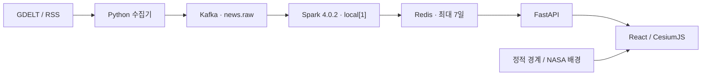

# TerraNewsphere

문의: [jaemanc93@gmail.com](mailto:jaemanc93@gmail.com)

**지구 위의 뉴스.** 최근 7일의 뉴스를 3D 지구본에서 지역별로 탐색하는 프로젝트다. 지구를 돌려 관심 지역을 찾고, 뉴스 마커의 미리보기를 확인한 뒤 원문으로 이동한다. 뉴스 탐색 UI와 Python 스트리밍 파이프라인의 개발·학습을 목적으로 한다.


> 화면은 2026-10-16 실제 앱에서 캡처했다. 기사·요약·기사 수는 문서용 가상 데이터이며, 썸네일은 기본 대체 이미지다. 예시 원문 링크는 `example.com`이다. [캡처 정보](docs/screenshots/README.md)

## 사용법

| 기능 | 사용 방법 |
| --- | --- |
| 지구본 탐색 | 드래그로 회전, 스크롤로 확대·축소. 왼쪽 위 버튼으로 사이드바를 접고 지도 오른쪽 위 **◎**로 초기 시점으로 돌아간다. |
| 지역 선택 | 국가를 선택해 뉴스를 좁힌다. 한국은 확대 단계에 따라 ADM1·ADM2 경계와 행정구역 선택을 제공한다. |
| 뉴스 미리보기 | 마커에 마우스를 올리면 썸네일·제목·제공 요약이 나타난다. 마커나 목록을 클릭하면 기사 카드가 열리고 **원문 기사 읽기**로 새 탭에서 원문을 연다. 모바일에서는 마커를 탭한다. |
| 목록·언어 | 목록은 최대 500개씩 **이전 / 다음**으로 이동한다. 헤더에서 한국어·영어를 바꾸면 브라우저에 선택이 저장된다. 기사 번역은 저장된 번역이 있을 때만 표시한다. |

**마커 읽기:** 기사당 대표 위치 하나를 표시한다. 민트색은 확인된 사건 지점, 주황색은 정확한 지점이 미확인인 위치 또는 혼합 묶음이다. 국가만 알려진 기사는 국가 안에 분산 표시하므로 실제 사건 지점으로 해석하면 안 된다. 큰 마커의 숫자는 묶인 기사 수이며 대표 기사의 미리보기가 열린다. 지도 조회는 목록 페이지와 별도이며 최대 1,000개의 위치 기사를 불러오므로 전체 보관 수와 마커 수는 다를 수 있다.

<details>
<summary>사용 화면 더 보기 — 전체 지도 · 지역 선택 · 호버 · 기사 카드 · 모바일</summary>

**사이드바를 접은 전체 지도**


**한국 지역 선택과 행정구역 필터**


**마커 호버 미리보기**


**클릭한 기사의 출처·지역·요약·원문 링크**


**모바일 지도**


</details>

## 로컬 실행

Python 3.12, uv, Node.js 22 이상과 실행 중인 Docker Desktop 또는 Docker Engine + Compose가 필요하다. 프로젝트 루트에서 실행한다.

```sh
sh scripts/setup.sh
docker compose up --build -d --wait
```

브라우저에서 **http://localhost:8080**을 연다. `setup.sh`가 의존성·로컬 인증값을 준비하고 기존 정적 지리 번들을 재사용한다. 최초 준비·이미지 빌드에는 인터넷 연결이 필요하다. 수집기·Kafka·Spark·Redis·API·웹이 함께 실행되며 첫 뉴스 처리까지 시간이 걸릴 수 있다.

```sh
docker compose ps                               # 서비스 상태
docker compose logs --tail=100 collector spark   # 수집·처리 로그
docker compose down                             # 종료
```

`.env`의 `WEB_PORT`로 웹 포트를 바꿀 수 있다. 기본 웹 포트는 localhost에만 연결되며 Redis/Kafka 포트는 공개하지 않는다. **Redis는 휘발 저장이므로 재시작하면 뉴스가 사라진다.** 일반 `down`은 Kafka·Spark의 named volume을 유지한다. 사내 CA가 필요한 환경의 빌드 설정은 [운영 문서](docs/operations.md#로컬-환경과-추가-ca)를 참고한다.

## 구성과 데이터



- 수집은 시작 즉시, 이후 기본 15분 간격이다. 공급자 호출 제한은 대기·재시도로 처리한다. Kafka는 입력 버퍼, Spark는 검증·정규화·지역 연결, Redis는 뉴스와 지역 색인, FastAPI는 화면 조회를 담당한다.
- 뉴스는 **최초 수집부터 최대 604800초(7일)** 보관한다. 중복 수집으로 만료를 연장하지 않는다. 제공되지 않은 요약·번역·이미지를 만들거나 기사 전문을 수집하지 않는다.
- 로컬 기본 RSS는 BBC·SBS·Le Monde·UN Geneva의 38개 피드다. **개인 로컬 이용 조건이며 공개·상업적 재배포 권한을 뜻하지 않는다.** 소스 추가와 썸네일 이용 조건은 [뉴스 소스 문서](docs/news-sources.md)를 따른다.
- 국가 경계는 Natural Earth, 한국 행정 경계는 geoBoundaries를 번들한다. 전 지구 배경은 로컬 NASA Blue Marble, 확대 배경은 온라인 OSM 또는 사용자 토큰의 Cesium ion을 사용한다. 경계·배경 출처와 지원 범위는 [지리 문서](docs/geography.md)를 참고한다.

## 검증·배포

준비가 끝난 뒤 `.venv/bin/python scripts/verify.py --containers`로 프런트 빌드, 배포 설정, 격리 Redis/API·만료 검사와 실제 Kafka→Spark→Redis→HTTP 경로를 검증한다. 이 명령은 로컬 서비스를 빌드·실행하며 검증 후에도 유지한다. 수행한 결과는 [진행 기록](docs/implementation-progress.md)에 남긴다.

브랜치는 **`feature/* → dev → prd`**, 병합은 필수 CI를 통과한 PR과 merge commit을 사용한다. `prd` 반영은 운영 후보 확정이며 서버 배포 실행을 뜻하지 않는다. 현재 클라우드 서버는 없고, 배포 설정은 OCI ARM64·단일 노드 K3s용이다. 전체 구성을 1GB VM이나 정적 웹 호스팅에 그대로 올리는 용도는 아니다.

실제 `.env`·비밀번호·인증서·개인키와 로컬 실행 데이터는 Git에서 제외한다. HTTPS·Redis ACL·요청 제한·네트워크 격리는 [보안 문서](docs/security.md), 이미지·K3s 설정과 복구는 [운영 문서](docs/operations.md)를 참고한다.

관련 문서: [브랜치 관리](docs/branching.md) · [데이터 계약](docs/data-contract.md) · [지리 데이터](docs/geography.md) · [뉴스 소스](docs/news-sources.md)
